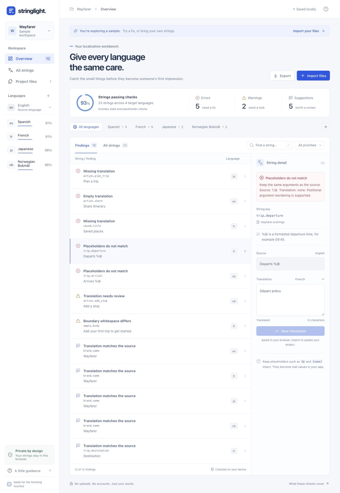

# Stringlight

A local localization preflight tool: review translation files in a browser, run the same checks in CI, and use the audit engine from JavaScript.

Import an Apple `.xcstrings` catalog or JSON locale files, inspect missing translations and incompatible placeholders, edit a value beside its source, and download the corrected file. No account, translation API, or backend is required.



Stringlight is a new implementation in an established category. Its focus is a readable browser workspace and a shared, deterministic engine for `.xcstrings` and simple JSON. It does not replace a translator, Xcode, or runtime testing. See [alternatives](#alternatives-and-scope) before choosing it for your project.

## Install in a project

Version **0.1.0** is distributed from [GitHub](https://github.com/kjdyrland/stringlight). It is **not published to the npm registry**. Install the versioned package asset from GitHub Releases:

```sh
npm install --save-dev https://github.com/kjdyrland/stringlight/releases/download/v0.1.0/kjdyrland-stringlight-0.1.0.tgz
npx stringlight MyApp/Resources/Localizable.xcstrings
```

The installed package is named `@kjdyrland/stringlight`; its executable is `stringlight`. Commit your `package.json` and lockfile so collaborators and CI install the same dependency. Requires Node.js **22.13+**.

## Command line

```sh
npx stringlight Localizable.xcstrings
npx stringlight en.json fr.json --source en --target de
npx stringlight en.json fr.json --format markdown --out audit.md
npx stringlight Localizable.xcstrings --fail-on warning
npx stringlight --version
npx stringlight --help
```

| Option | Behavior |
| --- | --- |
| `--source <locale>` | Source language for JSON files; defaults to `en`. Apple catalogs use their own `sourceLanguage`. |
| `--target <locale>` | Require a target language, including one absent from all inputs. Repeat to require several. |
| `--format json\|markdown` | JSON by default; both formats include findings and input problems. |
| `--out <path>` | Write the report to a file instead of stdout. |
| `--fail-on error\|warning\|info` | Lowest severity that fails the audit; defaults to `error`. |
| `--version` / `--help` | Show the installed version or usage. |
| `--` | Treat remaining arguments as file paths, including names beginning with a dash. |

The CLI reads localization files without changing them. It writes a report only with `--out`, and refuses an output path that aliases an input file. Report filenames are basenames; use unique names when auditing multiple catalogs.

| Exit code | Meaning |
| --- | --- |
| `0` | No finding reaches the selected failure threshold. |
| `1` | At least one finding reaches the selected threshold. |
| `2` | Invalid usage, filesystem failure, or input problem such as malformed JSON or unsupported non-string data. |

Warnings and suggestions do not fail the default check. `--fail-on warning` fails errors and warnings; `--fail-on info` fails all findings. Input problems always return `2`, even if the available portion of the report was emitted. A successful exit does not certify translation quality or release readiness.

After cloning this repository, try the [clean Apple catalog](examples/apple/Localizable.xcstrings), [JSON locale pair](examples/json/), or [deliberately broken catalog](examples/broken/Localizable.xcstrings):

```sh
node scripts/audit.mjs examples/apple/Localizable.xcstrings --target nb --target es
node scripts/audit.mjs examples/json/en.json examples/json/nb.json --source en
node scripts/audit.mjs examples/broken/Localizable.xcstrings
```

The broken example is expected to exit `1`.

## Add a release check

After installing the dependency, add a script to your application's `package.json`, adjusting the path and required languages:

```json
{
  "scripts": {
    "localization:check": "stringlight MyApp/Resources/Localizable.xcstrings --target nb --target es --fail-on error"
  }
}
```

Run `npm run localization:check` locally or in GitHub Actions:

```yaml
name: Localization
on: [push, pull_request]

permissions:
  contents: read

jobs:
  localization:
    runs-on: ubuntu-latest
    steps:
      - uses: actions/checkout@v7
      - uses: actions/setup-node@v7
        with:
          node-version: 22
          cache: npm
      - run: npm ci
      - run: npm run localization:check
```

CI is usually the best place for a release gate. For an optional read-only Xcode Run Script phase, this example assumes `package.json` and the `.xcodeproj` are in the same directory:

```sh
set -eu
cd "$SRCROOT"
./node_modules/.bin/stringlight \
  "MyApp/Resources/Localizable.xcstrings" \
  --fail-on error --format markdown
```

Adjust paths for your repository. Node must be on Xcode's `PATH`, and the script sandbox must permit reading the installed package and catalog. The command prints a report; it does not edit the catalog. Keeping the gate in CI avoids adding work to every local build.

## JavaScript API

The ESM API accepts file contents rather than filesystem paths, so the same engine can run in Node or a browser:

```js
import { auditFiles, updateTranslation } from '@kjdyrland/stringlight';

const files = [
  { name: 'en.json', text: '{"greeting":"Hello {name}"}' },
  { name: 'fr.json', text: '{"greeting":"Bonjour"}' },
];

const options = { sourceLocale: 'en', targetLocales: ['fr'] };
const report = auditFiles(files, options);
const finding = report.issues.find(issue => issue.type === 'placeholder');

if (finding?.fixable) {
  const corrected = updateTranslation(files, finding, 'Bonjour {name}');
  console.log(auditFiles(corrected, options).summary);
}
```

`auditFiles` returns input problems in `errors`, diagnostics in `issues`, and per-language results and a `summary`. `updateTranslation` returns new file records; saving them is the caller's choice. Unrelated JSON metadata is preserved, but serializing an edit can change whitespace formatting. Review the diff. See the [API reference](docs/API.md) for the data contract and repair limits.

## Browser workspace and development

```sh
git clone https://github.com/kjdyrland/stringlight.git
cd stringlight
npm ci
npm run dev
```

Open the local URL printed by Vite. Load the **Wayfarer** sample or import your files, filter by language and priority, save a correction, and export files or a report. Wayfarer is fictional and deliberately contains problems; it is not customer data or evidence of adoption.

| Command | Purpose |
| --- | --- |
| `npm test` | Run engine, regression, CLI, package, and TypeScript-consumer tests. |
| `npm run verify:package` | Pack and install into a fresh consumer; verify the CLI, API, types, and examples. |
| `npm run build` | Create the browser production bundle in `dist/`. |
| `npm run preview` | Serve the production bundle locally. |

The browser app is a static site. Build it and deploy `dist/` with your preferred static hosting provider. No server, database, or API secret is required. A generic Sites configuration is provided in `.openai/hosting.example.json`. If using Sites, create your own `.openai/hosting.json` with your own `project_id`; the author's local preview binding is excluded from the public source and package.

## Inputs and findings

- **Apple `.xcstrings`:** source text, states, comments, and plural/device leaves are read from the catalog. Source text falls back to the key when its source localization is absent. `shouldTranslate: false` entries are excluded.
- **JSON:** one language per file, named `en.json`, `nb.json`, or `common.es.json`, with flat or nested string values. Audit one namespace at a time. Locale-map bundles and multiple JSON files for the same language are unsupported. Literal dotted keys and nested paths stay distinct.

The browser accepts up to 30 files, 6 MB per file, and 12 MB per workspace. The CLI can audit larger files subject to available memory.

Errors identify missing/empty translations and incompatible placeholders. Warnings identify unfinished states, whitespace differences, and structures needing manual review. Suggestions include identical source/target text and spelled-out plural counts; names and shared words can correctly match.

**Strings passing checks** counts keys without blocking errors or outstanding state/format review. Whitespace and same-source suggestions do not reduce the percentage. The report field remains named `coverage`. This is a static-check metric, not a language-quality score.

### Current limits

- Common Foundation/printf arguments and simple `{name}` / `{{name}}` placeholders are checked. Positional reordering is supported, repeated references are distinguished from distinct arguments, and `%%` is a literal percent sign.
- ICU messages and Apple `%#@…@` named substitution formats require manual format review. Device variants, nested axes, substitutions, and unrecognized translation structures are flagged because complete coverage cannot be proved.
- Basic plural checks require `other`. They do not establish full CLDR category coverage. Fixed plural forms may spell out a numeric count; this is advisory. Missing an entire language for a varied source requires manual repair.
- JSON arrays, numbers, booleans, and null are preserved but not audited as translations; they are reported as input problems.
- No source-code extraction, hardcoded-string scanning, linguistic checking, rich-text validation, or runtime layout testing is performed. A language absent from all files must be requested explicitly.

Build and test your application in its supported languages. A clean report cannot establish cultural suitability, accessibility, text fit, correct runtime argument types, or App Store approval.

## Privacy and local storage

Browser parsing, checks, edits, and downloads happen locally. The CLI and library do not upload translation contents or call an AI service. The app includes no analytics SDK or remote fonts. Your hosting provider may retain ordinary page-request logs.

Exactly **one workspace** is saved in local browser storage. Importing another workspace or resetting the sample replaces it. Export current files first. Browser storage is not encrypted team storage, a backup, or synchronization; clearing site data removes it.

A workspace can fit the import limit and still exceed a browser's storage quota. If **Not saved** appears, export before closing: work may remain only in memory. Reports contain source text and translations, so share them according to your project's privacy requirements.

## Alternatives and scope

Similar tools already exist. Stringlight is useful if you prefer this browser review workflow and its shared JavaScript engine; it does not claim to be the first localization checker or the most complete Apple catalog validator.

| Project | Focus |
| --- | --- |
| [xckit](https://github.com/corrupt952/xckit) | Go CLI for `.xcstrings` inspection, editing, CSV workflows, linting, and advanced variations. |
| [Lingual i18n-check](https://github.com/lingualdev/i18n-check) | JSON/YAML ICU and i18next validation, with source-code unused/undefined key checks. |
| [xclocsmith](https://github.com/asutekku/xclocsmith) | Apple catalog linting/editing, language-specific plurals, source scanning, CI, and MCP integration. |
| [XCStrings web editor](https://github.com/rokartur/xcstrings-editor) | Browser/PWA `.xcstrings` editor with optional local Ollama translation. |
| [Shipglot](https://shipglot.com/tools/) | Browser localization check/edit/download tools and a documented multi-format CLI/CI gate. |

Parser behavior draws on [Apple's string catalog guide](https://developer.apple.com/documentation/Xcode/localizing-and-varying-text-with-a-string-catalog), [Discover String Catalogs](https://developer.apple.com/videos/play/wwdc2023/10155/), [Foundation format specifiers](https://developer.apple.com/library/archive/documentation/Cocoa/Conceptual/Strings/Articles/formatSpecifiers.html), and the older [stringsdict runtime format](https://help.apple.com/xcode/mac/current/en.lproj/devaf8b4090a.html). These are references, not a claim of full Apple schema compliance.

## Verification and project status

The first release includes synthetic fixtures and regression tests for parsing, findings, repairs, and CLI behavior. Two existing catalogs were also audited locally without committing or uploading their contents:

| Bytes | Keys | Target languages | Local Node audit |
| --- | --- | --- | --- |
| 898,624 | 1,415 | 2 | 22.08 ms |
| 4,195,836 | 1,102 | 19 | 81.69 ms |

These single measurements exclude file I/O and are not browser benchmarks. Both parsed without input errors or blocking findings. Six complex substitution entries in the larger catalog remained manual review. No linguistic or physical-device validation is implied.

This is an early release. Usefulness beyond our own workflows remains a hypothesis. The initial validation target is that at least 10 of the first 20 external users importing a valid catalog export a corrected file or actionable report in the same session. No external adoption, revenue, or commercial success is claimed.

[Contributing](CONTRIBUTING.md) · [Security](SECURITY.md) · [Changelog](CHANGELOG.md) · [MIT license](LICENSE)
